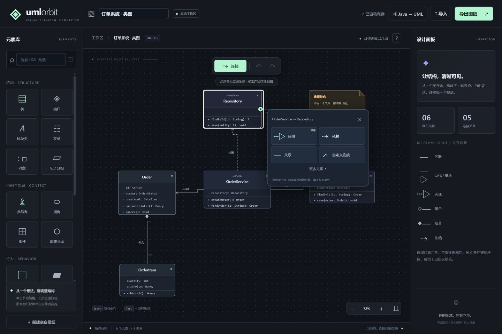

# UML Orbit

轻量、流畅的中文 UML 建模工作台。支持智能关系选择、自动避障连线、Java 输入辅助，以及从 Java 源码生成类图。

**纯前端 · 零第三方运行时依赖 · 浏览器本地存储 · GitHub Pages 自动部署**

[源码仓库](https://github.com/liang193/uml-orbit) · [Actions / 部署状态](https://github.com/liang193/uml-orbit/actions) · [部署说明](docs/DEPLOYMENT.md)



## 功能概览

| 功能 | 支持内容 |
| --- | --- |
| UML 建模 | 18 种常用图元，类 / 接口 / 抽象类及多种关系 |
| 简洁操作 | 单击编辑、长按拖动、空白处平移、关系小块点选 |
| 自动布局适配 | 类框随完整成员内容撑宽，每条属性和方法独占一行 |
| 智能连线 | 根据类型推荐关系，后台自动避障与路径复用 |
| Java 辅助 | 类型、项目内类名、字段名、模板补全及格式整理 |
| 源码生成图纸 | 导入多个 `.java` 文件或粘贴代码，分析后生成可编辑类图 |
| 文件与历史 | 自动保存、撤销重做、JSON 导入导出、SVG / PNG 导出 |
| 部署 | GitHub Actions 检查、测试、构建与 GitHub Pages 部署 |

## 在线部署

本仓库已包含 `.github/workflows/pages.yml`。首次启用时，在 **Settings → Pages → Build and deployment → Source** 中选择 **GitHub Actions**，然后从 Actions 页面手动运行工作流，或推送新提交到默认分支。之后默认分支的每次推送都会自动部署；Pull Request 和其他分支只运行检查与构建。[GitHub 官方配置说明](https://docs.github.com/en/pages/getting-started-with-github-pages/configuring-a-publishing-source-for-your-github-pages-site)。

部署成功后，访问 **https://liang193.github.io/uml-orbit/**。Fork 到其他账号后无需修改代码，部署地址会使用该账号与仓库名。站点支持仓库子路径，JavaScript 模块和后台 Worker 都采用相对路径。

在线版本仍将图纸与导入源码保存在访问者自己的浏览器内，不会把这些内容提交到仓库。GitHub Pages 只托管静态网站文件，不提供云端图纸同步。将本机图纸带到线上时，先在本机导出 JSON，再在线上导入。

## 启动

建议使用 Node.js 24（最低 22）。克隆后运行：

```sh
git clone https://github.com/liang193/uml-orbit.git
cd uml-orbit
npm ci
npm start
```

浏览器打开 http://127.0.0.1:5173 。Windows 也可以双击 `start.bat`。关闭终端即停止服务；再次启动即可继续使用。不要直接双击 `index.html`，浏览器的本地文件限制会阻止 JavaScript 模块运行。

如端口被占用，可在 PowerShell 中使用 `$env:PORT=5180` 后运行 `npm start`，访问对应端口。

## 构建与预览

```sh
npm run validate    # 检查语法、执行测试、生成静态站点
npm run preview     # 预览 dist/，默认 http://127.0.0.1:4173
```

`npm run build` 会重新生成 `dist/`，只复制页面、样式、图标与必要的 JavaScript / Worker 文件，排除测试、文档、本地服务和仓库配置。`dist/` 可以部署到 GitHub Pages 或其他支持 HTTPS 的静态托管服务。浏览器用户无需安装 Node.js。

验证 GitHub Pages 子路径：

```sh
npm run preview -- --base /uml-orbit/
```

访问 `http://127.0.0.1:4173/uml-orbit/`。

## 使用

- 左侧点击元素，弹窗填写名称、属性、方法、构造型和强调色。类可切换为接口或抽象类。属性 / 方法每行一条，支持 UML 可见性 `+ - # ~`，`{static}` 标记下划线、`{abstract}` 标记斜体。
- **单击节点编辑、长按约 180ms 后拖动**。不需要切换选择 / 拖动 / 编辑模式。长按后直接松开可只选中节点，右侧可复制、删除或发起连接。
- 点节点右侧的 **＋** 后点终点，或按 **C** 依次点击两个节点。在节点旁的小选择块中点一下关系类型，即刻创建，无须弹窗或再次保存。按类型推荐关系，但业务语义仍由你决定。点击同一节点两次可建立自连接。
- 单击已有关系弹出快捷块切换类型，**双击实际线段**展开完整设置，修改起终点箭头（无、开放箭头、空心三角、实心三角、空心菱形、实心菱形、空心圆）、线型、关系名和两端多重性。
- 普通类不显示 `«class»`；抽象类名用斜体；接口显示 `«interface»`。自定义构造型仍保留。所有类属性和方法完整显示，每条保持一行，节点按照最长文本自动扩宽，无省略号。
- 泛化 / 实现的三角指向父类 / 接口。聚合 / 组合的菱形位于整体端，即起点。弹窗可交换端点；右侧可反转已有关系。
- **直接拖动空白处**平移画布，也可使用滚轮或 Space + 拖动；Ctrl + 滚轮缩放，F 适应画布。
- Ctrl+Z 撤销、Ctrl+Shift+Z 或 Ctrl+Y 重做、Ctrl+D 复制节点、Delete 删除、Esc 返回选择模式。
- 自动保存至当前浏览器的 localStorage。导出 JSON 后可在其他浏览器导入继续编辑；SVG / PNG 用于文档或展示。浏览器清理站点数据会清除自动保存，建议定期导出 JSON。

## Java 编辑辅助

编辑类时支持常用 Java 类型、当前图纸中的类型、修饰符、字段命名与方法模板补全。↑↓ 选择，Tab / Enter 接受，Esc 关闭，Ctrl+Space 主动提示。支持中文输入法，组合输入期间不弹出补全。

属性和方法可以直接输入 Java 声明；失去焦点或保存时会整理为 UML 格式，也可以点击「整理格式」或按 Ctrl+Shift+F：

```text
private String name;                          → - name: String
public List<Order> findOrders(Long userId);    → + findOrders(userId: Long): List<Order>
public static void reset();                  → + reset(): void {static}
```

这是浏览器本地的轻量输入辅助，不是完整的 Java 编译器或 VS Code 语言服务器。不会连接远程 AI，不会分析运行时类型或编译错误。

## Java 源码生成 UML

顶部点击 **Java → UML**，粘贴源码或多选 `.java` 文件，点击「分析源码」查看识别数量与提示，然后「生成类图」。可追加到当前图纸或替换当前图纸；生成后可以撤销。

- 支持常见 `class`、`abstract class`、`interface`、`enum`、`record`、字段、方法、构造器及简单嵌套类。
- 从 `extends`、`implements` 生成泛化和实现关系；可选从字段引用（包括集合中的已知类型）生成有向关联，标签为字段名。
- 多文件按 `package` / 显式 `import` 解析同名类型。未找到的外部类型不会创建占位节点。
- 按继承层级和节点实际尺寸排布。长成员不截断、不换行；可放大或平移阅读。
- 本地后台解析，不运行源码。单批最多 100 个文件、总大小 1MB，单图最多 150 个元素、300 个关系。

结构解析器覆盖常用声明，尚不是完整 Java AST / 符号解析器。不展开 Lombok 生成成员、不解析构建依赖、不分析方法体中的调用、不可靠解析复杂注解参数 / 枚举常量体 / 所有新语法，不把字段引用猜测为聚合或组合。复杂项目应核对结果后手动调整。

## 元素与适用范围

支持 18 类常用图元：类、接口、抽象类、枚举、对象、包、参与者、用例、组件、部署节点、状态、活动、判断 / 合并、初始节点、终止节点、分叉 / 汇合、生命线、注释。

支持关联、有向关联、泛化、实现、依赖、聚合、组合、包含、扩展、控制流 / 消息、返回消息及自定义关系。

适合类图、用例图、状态图、活动图、组件图与部署图的常用绘制。生命线与消息可组合基础时序图，尚未实现完整的 UML 2.x 元模型、时序组合片段 / 时间轴语义校验、自动代码生成、XMI 交换、包内嵌套、多人协作和多图页管理。包目前是独立图元，不是可拖入节点的容器。

## 连线路由

使用正交可见性网格与 A* 寻路，每个节点外围保留安全边距。拖动节点或修改元素尺寸后会重新计算连线。线段不会穿过其他节点的包围盒。节点重叠或间距过小使端口被堵住时，关系仍保留，但不绘制误导性的穿透线，右侧显示提示与可编辑的关系列表。

本工具避免线条覆盖节点，不保证关系线之间互不相交或标签永不重叠。建议保留足够节点间距。单个项目限制为 150 个元素和 300 条关系。

## 流畅性优化

拖动时仅更新当前 SVG 节点的 transform，不重建整张 SVG 或持续重建右侧面板。移除了每个类框的 SVG 模糊阴影。寻路在 Web Worker 中执行，连续拖动只保留最新的待处理请求；旧结果不会覆盖新位置。

后台复用仍有效的路径，只重算端点改变或被新位置遮挡的连线。计算期间遮挡的旧路径会暂时隐藏，计算完成后恢复。Java 源码分析也在独立 Worker 中运行。导出图片会等待当前连线路径完成，复用已有结果。

`npm run bench` 可生成 `tests/fixtures/stress-60.json` 并测量 60 个类、104 条关系的后台路由。该机器一次测试中，初始路由约 38ms、未改变时约 0.13ms、移动一个类后约 1.5ms（重算 4 条、复用 100 条）。这些是寻路耗时，不代表整页 FPS；实际速度仍取决于设备、文本量和图纸布局。

## 开发验证

```powershell
npm run check
npm test
npm run bench
```

使用原生 HTML / CSS / JavaScript 与 SVG。构建仅打包静态资源，无编译器、外部字体或第三方运行时依赖。`server.mjs` 仅监听本机回环地址，线上不需要该服务。测试覆盖路由、路径复用、长成员尺寸、Java 格式整理、源码结构解析及仓库子路径部署。

## 项目结构

```text
.github/workflows/pages.yml  自动检查与 GitHub Pages 部署
index.html / styles.css     页面与样式
app.js                      画布、编辑、历史与文件操作
router.js                   节点尺寸和正交避障寻路
routing-engine.js           路径缓存与增量失效计算
routing-worker.js           后台路由线程
java-assist.js              Java 格式整理与补全候选
java-editor.js              编辑辅助界面
java-import*.js             Java 源码解析、后台线程与导入界面
scripts/                    静态资源清单、构建和语法检查
server.mjs                  开发 / 构建产物预览服务
tests/                      Node.js 内置测试与性能基准
docs/DEPLOYMENT.md           部署、更新、回退与故障排查
```

## 修改与贡献

修改后运行 `npm run validate`，确认检查、测试和构建通过，再提交更改。新增页面资源时同步更新 `scripts/site-files.mjs`，确保部署包包含该文件。提交 Bug 时请附浏览器版本、复现步骤和已去除业务数据的示例图纸。
